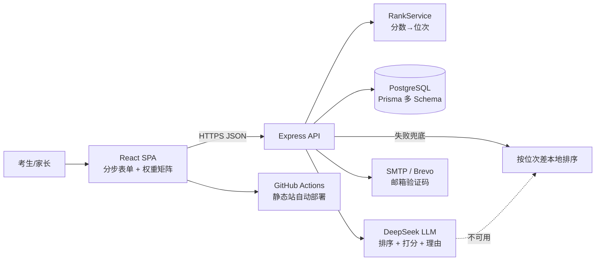

# AI 高考志愿填报助手

> 一套从 0 到 1 落地的高考志愿填报全栈应用：前端采集考生分数、位次、选科与偏好，后端用「数据库位次检索 + 大模型智能排序」两步法生成冲 / 稳 / 保 / 垫四梯度志愿方案，并提供录取风险诊断。


## 在线 Demo

> **可以直接点开体验**：[https://gaokao-advisor-demo-64324.app.workbuddy.host/?sharecode=IGU4NFEYN6](https://gaokao-advisor-demo-64324.app.workbuddy.host/?sharecode=IGU4NFEYN6)
>
> 打开后即可走完整流程：分步填写信息 → 自动反查位次 → 四梯度志愿推荐 → 录取风险诊断。
>
> **使用提示**：链接末尾的 `sharecode` 是访问凭证，请完整复制。若打开后跳转到 `/login` 并提示「链接不完整」，说明参数在跳转中丢失了——回到上面的完整链接重新进入，或在地址栏补上 `?sharecode=IGU4NFEYN6` 即可。
>
> 演示版为适应无数据库的单端口部署环境，使用内存数据 + 本地位次排序兜底，推荐理由为固定文案、无大模型个性化解释。它展示的是**产品流程与界面**；大模型的真实排序效果需按下方「快速开始」配置 API Key 后本地运行。

## 一眼看懂

| 维度 | 内容 |
|---|---|
| 产品形态 | Web 应用（React SPA + RESTful API） |
| 核心能力 | 位次换算 · 四梯度志愿推荐 · 风险诊断 · 邮箱验证登录 |
| 前端 | React 18 · TypeScript · Vite 6 · Tailwind CSS · Zustand |
| 后端 | Node.js 18 · Express 4 · TypeScript · Prisma 5 · PostgreSQL 16 |
| 智能层 | DeepSeek LLM（排序 + 专业匹配度 + 推荐理由），带本地兜底 |
| 工程化 | Docker Compose · GitHub Actions · Render / Vercel 部署 · Vitest 测试 |
| 数据规模 | 14 个 Prisma 模型 / 3 个 Schema；已入库 114 条批次线、172 条位次段、11 条选科覆盖记录 |

## 核心亮点

1. **推荐引擎采用两步法，而非把志愿数据全丢给大模型**：数据库先按位次区间筛出候选集，LLM 只负责排序、打「专业纯净度」分和写推荐理由。这样既控制了 Token 成本与幻觉风险，又让结果带上了自然语言解释。LLM 不可用时自动降级为按位次差排序，服务不中断。
2. **位次驱动的录取概率判断**：以省位次为核心锚点（比原始分数跨年份更稳定），按院校最低位次差距分档计算冲 / 稳 / 保 / 垫概率，替换了早期「线差法单点估算」的不稳定做法。
3. **数据契约做过一次彻底解耦**：把写死在前端的省份、科目、位次映射等抽成 JSON 静态配置，把需要后端下发的部分定义为动态接口，并逐项验证「改 JSON 前端即变」，让前后端可以并行开发。
4. **登录链路是可用的完整实现**：邮箱验证码注册、bcrypt 密码哈希、JWT 会话、失败次数锁定、验证码冷却与 TTL，全部落到了数据库和测试里，不只是页面壳子。
5. **真实数据经过两轮 QA 回归**：批次线、一分一段、选科覆盖均有可溯源数据；QA 曾拦截「覆盖率恒 100%」「超一本线分数硬编码 530」两个真实 Bug 并修复，测试报告留在了仓库中。

## 架构一图



## 快速开始

```bash
# 1. 后端（内存模式，无需数据库，最快跑通）
cd gaokao-backend
cp .env.example .env          # 将 USE_DATABASE 设为 false
npm install
npm run dev                   # http://localhost:3000

# 2. 前端（另开一个终端）
cd gaokao-app
npm install
npm run dev                   # http://localhost:5173

# 3. 接入真实数据 + 大模型（可选）
#    参见 docs/07-部署与运维.md，设置 USE_DATABASE=true 与 DEEPSEEK_API_KEY
```

> Windows 用户可直接双击 `gaokao-backend/start-backend.bat` 与 `gaokao-app/start-frontend.bat` 一键启动。

## 文档导航

| 文档 | 内容 |
|---|---|
| [01 · 项目概述与产品定位](docs/01-项目概述与产品定位.md) | 三大痛点、差异化选型、实现范围声明 |
| [02 · 技术架构](docs/02-技术架构.md) | 分层设计、技术选型理由、双存储模式、数据流 |
| [03 · 核心功能实现](docs/03-核心功能实现.md) | 信息采集、位次换算、风险诊断、认证链路 |
| [04 · 推荐引擎详解](docs/04-推荐引擎详解.md) | 两步法全流程、概率算法、LLM 集成与降级 |
| [05 · 数据库设计](docs/05-数据库设计.md) | 14 个模型、3 个 Schema、索引与迁移 |
| [06 · API 接口](docs/06-API接口.md) | 17 个接口、请求响应示例、错误码 |
| [07 · 部署与运维](docs/07-部署与运维.md) | Docker Compose、CI/CD、云部署、一键脚本 |
| [08 · 测试与验证](docs/08-测试与验证.md) | 两轮 QA、真实数据核对、测试结果 |
| [09 · 简历项目描述](docs/09-简历项目描述.md) | 可直接复用的简历文案 + 面试问答 |
| [10 · 实现边界与后续规划](docs/10-实现边界与后续规划.md) | **已实现 / 设计中标明**，诚实清单 |

## 关于文档真实性

本项目文档刻意区分三类内容，避免把设计目标误写成落地成果：

- **已实现**：源码、数据库迁移、接口测试可验证的部分 → 直接陈述。
- **设计中**：架构文档里提出但未编码的部分（如 Redis 缓存、限流熔断、读写分离）→ 明确标注「设计中」，不计入成果。
- **容量规划**：流量模型推演出的 QPS / 容量数字 → 明确标注「估算目标，非实测」。

详见 [10 · 实现边界与后续规划](docs/10-实现边界与后续规划.md)。
