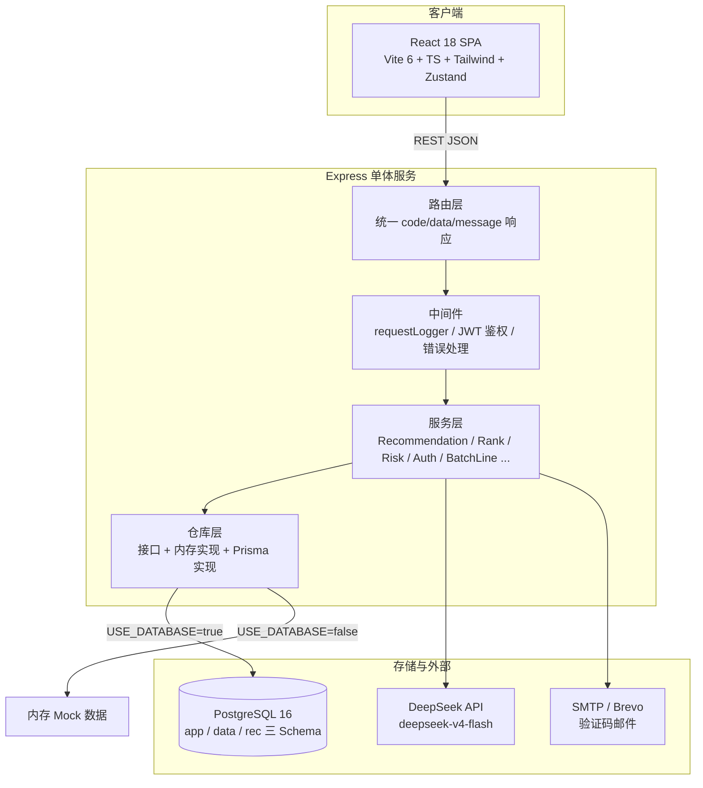

# 02 · 技术架构

## 1. 架构总览

项目采用「前后端分离 + 数据库仓库模式（Repository Pattern）+ 外部大模型」的实用架构。它是一个**模块化单体**，不是微服务——这是有意为之的选择：高考志愿填报流量高度集中在出分日前后，平时负载低，拆分微服务的运维成本远高于收益。



## 2. 技术选型与理由

### 前端

| 技术 | 版本 | 选型理由 |
|---|---|---|
| React | 18.3.1 | 生态成熟，组件化适合分步表单与结果卡片 |
| TypeScript | ~5.6.2 | 与后端共享数据契约类型，减少联调歧义 |
| Vite | 6.0.3 | 构建快，配置简单，出包约 112KB gzip |
| Tailwind CSS | 3.4.17 | 快速实现「阳光、有生气」的视觉风格 |
| Zustand | 5.0.2 | 轻量状态管理，承载跨步骤的考生表单数据 |
| motion | 11.18 | 结果页/步骤切换动效 |
| lucide-react | 0.468 | 图标 |
| React Router | 6.28 | 页面路由与受保护路由 |

设计上有一个 `design-system.tsx`（约 17KB）集中封装了配色、组件与样式 token，保证「蓬勃向上」的视觉基调在各页面一致。

### 后端

| 技术 | 版本 | 选型理由 |
|---|---|---|
| Node.js | ≥18 | 与前端同语言，降低切换成本 |
| Express | 4.19.2 | 稳定、生态全，足够承载单体 API |
| TypeScript | 5.5.3 | 类型安全 |
| Prisma | 5.16.2 | Schema 即文档，迁移可版本化，多 Schema 支持 |
| PostgreSQL | 16 | 关系型数据（院校/专业/分数）天然适配；数组类型存标签与选科要求 |
| jsonwebtoken / bcrypt | 9.0.2 / 5.1.1 | 会话签名与密码哈希 |
| nodemailer | 6.9.8 | 邮箱验证码发送 |
| tsx | 4.16.2 | 开发热重载、脚本执行 |
| Vitest + Supertest | 4.1.9 / 7.2.2 | 接口级自动化测试 |

> 注：早期架构文档曾设想 MUI、Redis Cluster、API Gateway、gRPC 等组件。**源码实际未采用 MUI、Redis、网关或 gRPC**，以源码为准。

## 3. 关键设计决策

### 3.1 仓库模式 + 双存储开关

后端通过 `USE_DATABASE` 环境变量在两套实现间切换：

```ts
// routes/index.ts 中的认证仓库选择
const useDatabase = process.env.USE_DATABASE !== 'false';
const authRepository = useDatabase
  ? new PrismaAuthRepository()
  : new InMemoryAuthRepository();
```

- `USE_DATABASE=false`：全部走内存 Mock JSON，零依赖即可跑通全链路，适合演示与前端联调。
- `USE_DATABASE=true`：走 Prisma + PostgreSQL，用于真实数据与持久化。

服务层同样通过构造函数注入依赖（如 `RecommendationService` 注入 `RankService`、`LlmService` 等），使得单元测试可以替换实现。

### 3.2 统一响应契约

所有接口统一返回 `{ code, data, message }`：

```ts
const success = <T>(data: T) => ({ code: 0, data, message: 'ok' });
const fail = (message: string, code = 400) => ({ code, data: null, message });
```

路由同时挂在 `/api` 前缀与根路径下，便于本地调试和 Vercel 反代配置兼容。

### 3.3 数据与逻辑解耦

项目做过一次专项解耦：把前端散落的硬编码数据拆成两类。

- **静态配置**（前端自带）：`src/config/` 下的 `provinces.json`（省份）、`subjects.json`（选科）、`options.json`（院校层次/城市/专业类别等选项）、`rankLookups.json`（位次兜底）。
- **动态数据**（后端下发）：省份列表、位次查询、批次线、选科覆盖、推荐结果、风险诊断。

验证方式是「改 JSON 里一个值 → 刷新前端看是否变化 → 改回来」，确认解耦生效。详见 `gaokao-backend/DATA_DECOUPLING.md`。

### 3.4 可观测性（轻量实现）

`app.ts` 中的 `requestLogger` 中间件在控制台打印 `method / path / status / duration`，生产部署时由 Docker 日志收集。项目提供了实时控制台输出 + 定时写盘的日志方案（见 `deploy.sh` 与部署文档）。

> 架构文档中提到的 APM、云日志、链路追踪属于**设计中**，未接入。

## 4. 数据流：一次推荐请求的完整路径

以 `POST /api/recommend` 为例：

1. 路由层校验 `province` 与 `score` 必填，规范化 `preferences` 字段类型。
2. `RankService` 把分数换算为省位次（若用户已提供 `rank` 则跳过）。
3. `AdmissionScoreService` 按位次区间从数据库查出冲 / 稳 / 保 / 垫四档候选。
4. `CityUniversityService` 按城市偏好过滤；若过滤后不足 4 条则保留全量兜底。
5. `UniversityPlanService` 补充招生计划、专业、学费、选科要求。
6. `LlmService` 对候选集排序、打专业匹配度分、写推荐理由。
7. 任一环节失败 → 降级为按位次差排序；数据库与 LLM 都失败 → 返回空数组并记录告警日志。
8. 统一封装为 `{ code: 0, data: [...], message: 'ok' }` 返回。

完整算法见 [04 · 推荐引擎详解](04-推荐引擎详解.md)。
