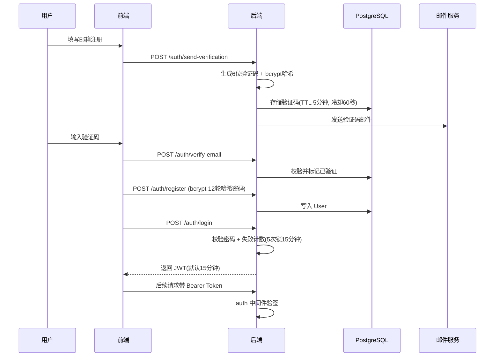

# 03 · 核心功能实现

## 1. 考生信息分步采集（Wizard）

前端把信息收集拆成多步，避免长表单疲劳：

| 步骤 | 采集内容 | 来源 |
|---|---|---|
| 基本信息 | 省份、选科组合、总分、特殊身份/加分 | 用户填写 |
| 位次定位 | 省位次 | 系统按分数 +  province + subjectType 自动反查，用户可手动覆盖 |
| 偏好设置 | 院校层次、期望城市、学科门类、目标专业、职业倾向、权重数组 | 用户填写 |
| 结果 | 四梯度志愿列表 + 风险诊断 | 后端返回 |

省份、选科、各类选项来自前端 `src/config/*.json` 静态配置，改配置即时生效，无需重新发版后端。

## 2. 选科组合合法性校验

选科是志愿填报的硬约束：专业组有选科要求，组合非法会直接导致志愿无效。规则层定义了三类高考模式：

- **传统文理**：文科 / 理科。
- **3+3 模式**（如浙江）：从 7 科中选 3，校验重复、不足 3 门、超过 3 门；合法组合约 20 种（浙江含技术科目约 35 种）。
- **3+1+2 模式**（主流）：首选物理或历史，再选从化学/生物/政治/地理中选 2。校验规则包括：首选未选、物理与历史同选、再选不足 2 / 超 2 / 重复、与首选冲突等，合法组合 12 种。

错误码形如 `TRAD-01`、`3+3-1` ~ `3+3-4`、`3+1+2-1` ~ `3+1+2-7`，便于前端定位提示。

> 状态说明：完整的校验规则函数在 PRD 中定义；源码中 API 层对 `subjectType` 做了合法枚举校验，前端表单做了基础校验。**PRD 级别的完整组合校验矩阵尚未逐条编码进后端接口**，属于下一步工作。

## 3. 位次换算（RankService）

高考录取按省排名（位次）竞争，同一分数在不同年份位次不同，因此「位次」比「分数」是更稳定的推荐锚点。

`RankService.lookup(score, province, subjectType)` 查询 `rank_lookups` 表（Schema `rec`），返回：

```json
{
  "rank": 46934,
  "sameScore": 1262,
  "rangeMin": 46200,
  "rangeMax": 47500
}
```

查询优先命中数据库；无数据库时回退到 `src/data/json/rankLookups.json` 静态兜底数据。QA 阶段实测：广东物理类 585 分 → 位次 46934、同分 1262 人，与一分一段表一致。

## 4. 四梯度志愿推荐

详见 [04 · 推荐引擎详解](04-推荐引擎详解.md)。简要流程：数据库按位次区间初筛 → 城市偏好过滤 → 专业与招生计划匹配 → LLM 排序与理由生成 → 输出冲 / 稳 / 保 / 垫各 2 条。

## 5. 风险诊断（RiskService）

`POST /api/risk` 接收考生输入与推荐方案，调用 LLM 返回 6 项诊断：

1. 梯度合理性检查（冲稳保垫配比是否失衡）
2. 志愿撞车检测（同一院校专业组重复）
3. 必填志愿数检查（是否填满）
4. 重复院校检查
5. 选科要求复核（专业组选科是否匹配）
6. 专业纯净度均值（是否混入不接受的专业）

`GET /api/risk` 提供不带考生上下文的静态兜底数据，用于前端首屏占位和 LLM 不可用时的降级展示。

## 6. 邮箱验证码登录体系

一套完整可用的认证链路，代码位于 `authService.ts` / `authRoutes.ts` / `emailService.ts`：



安全参数：

| 参数 | 值 | 说明 |
|---|---|---|
| 密码哈希 | bcrypt 12 轮 | 防彩虹表 |
| 验证码 | 6 位，bcrypt 哈希入库 | 不明文存储 |
| 验证码 TTL | 5 分钟 | 过期失效 |
| 同邮箱同类型冷却 | 60 秒 | 防刷 |
| JWT 有效期 | 15 分钟（可配） | 短周期 |
| 登录失败锁定 | 5 次 → 15 分钟 | 防暴力破解 |

前端配套 `AuthContext`、`ProtectedRoute`、`ResendButton` 组件，路由级保护与验证码重发倒计时均已实现。`auth.test.ts`（约 25KB）覆盖了注册、登录、锁定、验证码等核心场景。

## 7. 静态兜底与动态接口的分工

| 能力 | 静态配置 | 动态接口 | 兜底关系 |
|---|---|---|---|
| 省份列表 | `config/provinces.json` | `GET /api/provinces` | 接口失败用静态 |
| 位次映射 | `config/rankLookups.json` | `GET /api/rank-lookup` | JSON 兜底 |
| 批次线 | — | `GET /api/batch-lines` | 数据库无数据返回空 |
| 选科覆盖 | — | `GET /api/subject-coverage` | 数据库无数据返回空 |
| 推荐结果 | `config/options.json` 中的示例 | `POST /api/recommend` | LLM 失败按位次排序 |
| 风险诊断 | `data/json/riskChecks.json` | `POST /api/risk` | GET 静态兜底 |

这种「双层兜底」设计是项目的一个工程特点：任何单一环节失败，用户都能看到有意义的降级结果，而不是空白页或报错。
