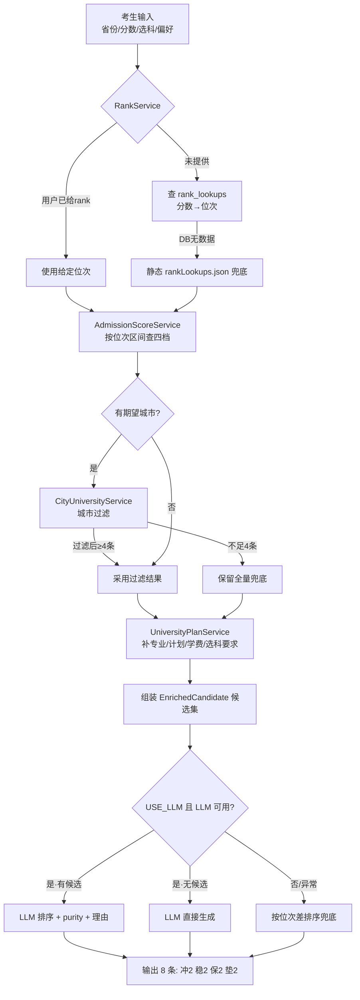

# 04 · 推荐引擎详解

推荐引擎是本项目的技术核心。它经历过一次重要重构：从「线差法单点估算 + 大模型自由生成」升级为「数据库位次检索 + 大模型排序」两步法。本文说明当前实现的设计思路与算法细节。

## 1. 为什么改成两步法

早期方案有两个问题：

1. **分数跨年不可比**：同一分数在不同年份位次差异很大，直接用分数线做匹配会失准。
2. **大模型不该负责事实数据**：让 LLM 直接「生成」院校名单和分数，容易编造不存在的录取数据（幻觉），且 Token 成本高、延迟不可控。

当前实现把职责切开：

- **数据库负责事实**：位次、院校、专业、招生计划、历年分数都是真实入库数据，由 SQL 精确检索。
- **大模型负责判断**：在给定的候选集内做排序、评估专业匹配度、撰写推荐理由。LLM 不再凭空生成院校与分数。

源码注释里的三步概括：

```
Step 1: RankService 分数 → 位次换算
Step 2: 数据库按位次查四档 → 城市过滤 → 专业与计划匹配
Step 3: LLM 排序 + purity + 理由（失败则按位次差排序兜底）
```

## 2. 完整流程图



## 3. 位次区间与四档划分

`AdmissionScoreService.queryByRank(provinceCode, userRank, year, batch)` 按用户位次与院校历年最低位次的关系，划出四个梯度（源码中的比例系数）：

| 档位 | 位次区间系数（相对用户位次） | 含义 |
|---|---|---|
| 冲 | 0.77 ~ 1.0 | 往年最低位次优于用户，冲刺 |
| 稳 | 0.5 ~ 0.85 | 位次接近，录取概率较高 |
| 保 | 0.25 ~ 0.5 | 往年最低位次明显低于用户，保底 |
| 垫 | 更宽松区间 | 兜底垫仓 |

每档候选上限约 15 所院校 × 3 个专业 = 45 条，最终由 LLM 或兜底逻辑各选 2 条，合计 8 条。

## 4. 录取概率计算

`calcProbability()` 用「位次差距 / 院校最低位次」的比值计算概率，而不是简单的线性分数差：

```ts
const gapRatio = rankGap / minRank;  // 0 = 完全 coincide，越大差距越大

switch (tier) {
  case '冲': return Math.max(5,  Math.round(30 - gapRatio * 100));
  case '稳': return Math.max(30, Math.round(65 - gapRatio * 150));
  case '保': return Math.max(50, Math.round(90 - gapRatio * 100));
  case '垫': return Math.max(70, Math.round(98 - gapRatio * 50));
}
```

当 `minRank` 缺失时，直接按档位返回参考概率（冲 15 / 稳 55 / 保 85 / 垫 98）。概率结果随结果卡片一起展示给考生，作为决策辅助。

## 5. LLM 集成

### 5.1 接入方式

```ts
// app.ts：有 API Key 才注入 LlmService
const llmService = process.env.DEEPSEEK_API_KEY
  ? new LlmService({
      apiKey: process.env.DEEPSEEK_API_KEY,
      baseUrl: 'https://api.deepseek.com/v1',
      model: process.env.DEEPSEEK_MODEL || 'deepseek-v4-flash',
      timeout: 60000
    })
  : undefined;
```

- 有 Key：真实调用 DeepSeek API。
- 无 Key：`llmService` 为 undefined，自动走数据库兜底排序，功能仍可用。
- 调用异常：捕获后打印告警日志，降级到本地排序。

### 5.2 LLM 的职责边界

`LlmService` 的两个核心方法：

| 方法 | 触发条件 | 职责 |
|---|---|---|
| `rankAndEnrich(candidates, input, userRank)` | 数据库筛出候选集 | 在候选集内排序、打 purity（专业匹配度，0-100）、写 ≤30 字理由 |
| `generateRecommendations(input)` | 数据库无候选 | 仅凭考生信息生成推荐（受限模式，仅在没有事实时使用） |

提示词明确要求模型**不得编造分数与院校数据**，只能基于传入的候选集输出。这是控制幻觉的关键约束。

### 5.3 降级策略汇总

| 故障场景 | 降级行为 |
|---|---|
| 未配置 API Key | 不走 LLM，直接用 DB 排序 |
| LLM 调用超时 / 异常 | 按位次差排序，purity 默认 70，理由为「基于历年录取位次自动推荐」 |
| 数据库无候选 + LLM 不可用 | 返回空数组并打印告警 |
| 城市过滤后不足 4 条 | 保留全量候选，不做过滤 |

## 6. 候选数据结构

传给 LLM 的 `EnrichedCandidate` 包含：

```ts
{
  universityId, universityName, majorId, majorName, city, provinceCode,
  minRank, avgRank, minScore, avgScore,   // 历年录取数据
  planCount, tuition,                      // 招生计划
  tier,                                    // 冲/稳/保/垫
  rankGap,                                 // 与用户位次差
  scores: [{ year: 2023, score }, ...],    // 三年趋势
  trend,                                   // 涨跌趋势
  subjectRequirements                      // 选科要求
}
```

最终返回的 `RecommendationItem` 在前端结果页渲染为志愿卡片，展示院校、专业、城市、历年分数趋势、录取概率、匹配度和推荐理由。

## 7. 性能与成本考量

- **Token 成本**：只把筛选后的候选集（通常 ≤45 条）传给 LLM，而非全量院校库，显著降低输入 Token。
- **响应速度**：实测一次完整推荐约 9-10 秒（含 LLM 调用）；降级路径为毫秒级。
- **后续优化方向**：架构文档中提出「预计算位次映射表 + Redis 缓存热点推荐」，可将重复请求降到毫秒级，但**当前未实现**，见 [10 · 实现边界与后续规划](10-实现边界与后续规划.md)。
