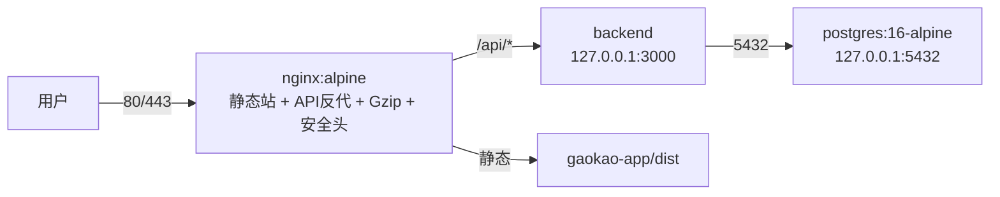

# 07 · 部署与运维

项目提供从本地一键启动到云端生产部署的完整路径。

## 1. 本地开发

### 前端

```bash
cd gaokao-app
npm install
npm run dev        # http://localhost:5173
npm run build      # 产出 dist/
```

Windows 下可双击 `start-frontend.bat` / `stop-frontend.bat`。

### 后端（两种模式）

```bash
cd gaokao-backend
cp .env.example .env
npm install
npm run dev        # http://localhost:3000
```

- **内存模式**（`USE_DATABASE=false`）：零依赖，读写 Mock JSON，最快跑通。
- **数据库模式**（`USE_DATABASE=true`）：需先初始化 PostgreSQL。

Windows 下双击 `start-backend.bat` 会自动检查并启动 PostgreSQL，再拉起后端；`stop-backend.bat` 一键停止。

### 本地 PostgreSQL 初始化

仓库附带便携版初始化脚本 `init-postgres.bat` / `.sh`：

- 数据目录固定在 `C:\gaokao-pgdata`（避开中文路径）。
- Windows 中文路径下 UTF8 初始化会报错，因此用 `--locale=C -E SQL_ASCII`。
- 初始化后执行 `npx prisma migrate dev` 与 `npm run db:seed` 建表并灌种子数据。

## 2. 生产部署（Docker Compose）

`docker-compose.prod.yml` 编排三个服务：



- **postgres:16-alpine**：绑定 `127.0.0.1:5432`，带 `pg_isready` 健康检查。
- **backend**：绑定 `127.0.0.1:3000`，带 `curl /api/health` 健康检查；Dockerfile 多阶段构建。
- **nginx:alpine**：挂载前端构建产物与 `nginx.conf`，配置 SPA 路由回退、API 反向代理、Gzip 与安全响应头。

部署命令：

```bash
# 1. 复制环境变量模板并填写真实值
cp .env.prod.template .env.prod
#    必填：DB_PASSWORD / JWT_SECRET / BREVO_API_KEY / DEEPSEEK_API_KEY

# 2. 一键部署
docker compose --env-file .env.prod -f docker-compose.prod.yml up -d --build
```

`/deploy.sh` 脚本把流程串成五步：本地构建前端 → 校验 `.env.prod` 必填项 → scp 传到服务器 `/opt/gaokao` → ssh 执行 `docker compose up -d --build` → `curl /api/health` 验证。

## 3. CI/CD

`.github/workflows/gh-pages.yml` 配置了前端自动部署：

- 触发：`push` 到 `main` 分支且 `gaokao-app/**` 有变更。
- 步骤：`checkout@v4` → `setup-node@v4`（Node 18）→ `npm ci` → `npm run build`（注入 `VITE_API_BASE_URL`）→ `upload-pages-artifact@v3` → `deploy-pages@v4`。
- 结果：前端静态站自动发布到 GitHub Pages。

> 注意：GitHub Pages 只托管静态前端，API 请求需指向已部署的后端。前端 `vercel.json` 中配置了 `/api/(.*)` 到 Render 后端的重写规则。

## 4. 云端运行的实际配置

- **后端**：Render（`render.yaml` 提供 Blueprint 配置）。
- **前端**：Vercel / GitHub Pages 静态托管。
- **数据库**：PostgreSQL 16（云上可用托管实例，本地用便携版）。

早期部署评估过腾讯云 Lighthouse（4 核 8G，约 ¥112/月，覆盖 10 万 DAU 内）与 CVM + TencentDB（约 ¥2870–4000/月）等方案，相关分析见原有部署文档。

## 5. 日志与排障

- **实时日志**：`requestLogger` 中间件在控制台打印 `method / path / status / duration`。
- **定时写盘**：生产脚本配合重定向把日志落盘，便于事后排查。
- **健康检查**：`GET /api/health` 用于 Docker healthcheck 与外部探活。
- **调试脚本**：`scripts/debugData.ts`、`checkCounts.ts`、`quickTest.ts` 用于核对入库数据与快速验证。

## 6. 环境变量

| 变量 | 默认值 | 说明 |
|---|---|---|
| `PORT` | 3000 | 后端端口 |
| `CORS_ORIGINS` | localhost:5173 | 允许的前端源，多个逗号分隔 |
| `USE_DATABASE` | false | 是否启用 PostgreSQL |
| `DATABASE_URL` | — | PostgreSQL 连接串 |
| `USE_LLM` | true | 是否启用大模型 |
| `DEEPSEEK_API_KEY` | — | 大模型密钥 |
| `DEEPSEEK_BASE_URL` | api.deepseek.com/v1 | 大模型 API 地址 |
| `DEEPSEEK_MODEL` | deepseek-v4-flash | 模型名 |
| `JWT_SECRET` | dev-secret | JWT 签名密钥（生产必改） |
| `JWT_EXPIRES_IN` | 15m | 会话有效期 |
| `LOGIN_MAX_ATTEMPTS` | 5 | 登录失败锁定阈值 |
| `LOGIN_LOCK_MINUTES` | 15 | 锁定时长（分钟） |

> 所有模板文件（`.env.example`、`.env.prod.template`）只含占位值，无真实密钥。真实密钥请通过环境变量或 `.env.local`（已加入 `.gitignore`）注入。
